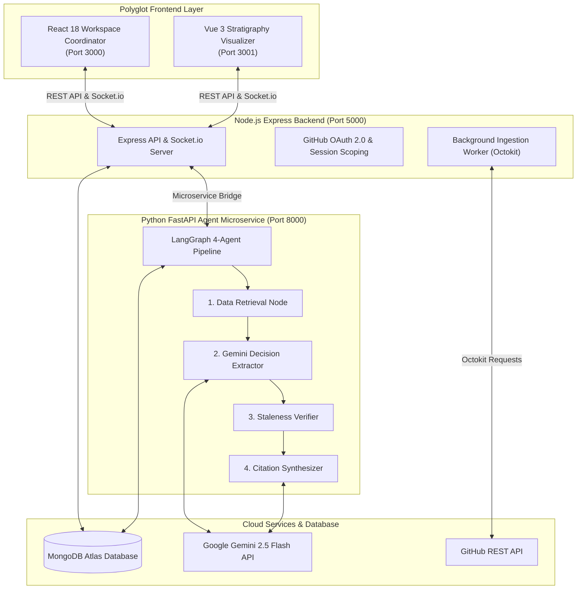

<div align="center">

  <!-- Custom Logo Header -->
  <svg xmlns="http://www.w3.org/2000/svg" viewBox="0 0 64 64" fill="none" width="80" height="80">
    <rect width="64" height="64" rx="16" fill="#E5A853"/>
    <rect x="4" y="4" width="56" height="56" rx="13" fill="#1D1A16"/>
    <path d="M12 18H52" stroke="#E5A853" stroke-width="6" stroke-linecap="round"/>
    <path d="M12 32H52" stroke="#F5F0E6" stroke-width="6" stroke-linecap="round"/>
    <path d="M12 46H52" stroke="#3AAFA9" stroke-width="6" stroke-linecap="round"/>
    <path d="M32 20L43 32L32 44L21 32Z" fill="#E5A853" stroke="#1D1A16" stroke-width="3"/>
    <circle cx="32" cy="32" r="3" fill="#1D1A16"/>
  </svg>

  # 🏺 Chronicle — AI Code Decision Archaeology

  **Uncovering the "Why" Behind Codebases via Multi-Agent LLM Orchestration & Real-Time Git Synthesis**

  [](https://react.dev/)
  [](https://vuejs.org/)
  [](https://nodejs.org/)
  [](https://fastapi.tiangolo.com/)
  [](https://www.langchain.com/langgraph)
  [](https://ai.google.dev/)
  [](https://www.mongodb.com/)

</div>

---

## 🌐 Live Deployments & Environment URLs

| Service / App | Platform | URL / Endpoint |
| :--- | :--- | :--- |
| **React App (Workspace Coordinator)** | Vercel | `http://localhost:3000` |
| **Vue App (Decision Visualizer)** | Vercel | `http://localhost:3001` |
| **Node.js Express Backend** | Render | `http://localhost:5000` |
| **Python LangGraph Agent** | Render | `http://localhost:8000` |

---

## 💡 The Problem & Engineering Motivation

Every production codebase suffers from **Tribal Knowledge Decay**.

Developers frequently stare at complex, seemingly counterintuitive lines of code and ask:
> *"Why on earth was this written this way? Is this a critical bug fix, an edge-case workaround, or dead legacy code that we can safely refactor?"*

Standard git blame only shows *who* changed a line and *when*. It doesn't explain **why** the decision was made.

### 🎯 The Solution: Chronicle
**Chronicle** is a production-grade **Code Decision Archaeology System**. It orchestrates autonomous AI agents to crawl commit histories, code diffs, pull request conversations, and review comments. 

Chronicle reconstructs the engineering context behind any target file or function, produces **cited architectural decision timelines**, and autonomously detects **stale decisions** whose original premises have been invalidated by subsequent commits.

---

## 🔥 Key Technical Highlights & Innovations

* 🧠 **Autonomous Multi-Agent Pipeline (LangGraph + Gemini 1.5 Flash)**: Implements an asynchronous 4-node state graph (Data Retrieval, Decision Extraction, Staleness Verification, and Citation Synthesis) to analyze git blame and PR review threads without hallucination.
* 🛡️ **Real GitHub OAuth & Multi-Tenant Scoping**: Supports full GitHub OAuth 2.0 app authorization and Personal Access Token (PAT) fallbacks. Repositories, decisions, and chat threads are isolated per user (`githubUsername`) in MongoDB.
* ⚡ **Real-Time WebSocket Tracing**: Uses Socket.io to stream granular agent execution steps (`retrieving`, `extracting`, `verifying`, `synthesizing`) live to the frontend interface.
* 🎨 **Polyglot Design System ("Stratigraphy Palette")**: Combines React 18 + Redux Toolkit for workspace coordination with a custom Vue 3 timeline visualizer, styled with IBM Plex typography and warm soil/ochre glassmorphism.
* 🔐 **Automated Security Safeguards**: Features an automated 1-hour session security auto-logout timer and grace error handling for OAuth cancellations.

---

## 🏗️ System Architecture & Workflow



---

## 🛠️ Tech Stack & Architecture Deep Dive

| Component | Framework / Tool | Highlights |
| :--- | :--- | :--- |
| **Frontend Coordinator** | React 18, Redux Toolkit, Vite | Manages workspace state, GitHub OAuth sessions, and real-time live tracing indicators. |
| **Timeline Visualizer** | Vue 3, Lucide Icons | Renders chronological sediment layers, staleness badges, and side detail drawers. |
| **Styling & UI Tokens** | Tailwind CSS v3 | Curated "Stratigraphy" palette (soil `#1D1A16`, ochre `#E5A853`, teal `#3AAFA9`, rust `#D9534F`). |
| **Backend API** | Node.js, Express, Socket.io | Manages user scoping, OAuth code-for-token exchange, and dynamic Octokit client instances. |
| **Agent Microservice** | Python 3.10+, FastAPI | Runs async LangGraph workflows with Pydantic payload validation. |
| **LLM Reasoning** | LangChain + Gemini 1.5 Flash | Structured JSON parsing, zero-shot decision extraction, and semantic grounding. |
| **Database** | MongoDB Atlas, Mongoose, Motor | Indexed composite keys (`owner`, `name`, `githubUsername`) for multi-tenant isolation. |

---

## 📂 Project Monorepo Layout

```text
Chronicle/
├── backend/                  # Express API Server & Ingestion Engine
│   ├── src/
│   │   ├── models/           # Mongoose schemas (Repo, Commit, PullRequest, DecisionRecord, ChatSession)
│   │   ├── services/         # Dynamic Octokit GitHub API client & background worker
│   │   └── server.js         # API endpoints & Socket.io event emitter
│   └── package.json
├── agent-service/            # FastAPI Python Microservice (LangGraph + Gemini)
│   ├── database.py           # Async Motor MongoDB connector
│   ├── llm.py                # LangChain Gemini 1.5 Flash client & key fallback
│   ├── graph.py              # LangGraph multi-agent pipelines (Extraction & Chat RAG)
│   ├── main.py               # FastAPI server entrypoint
│   └── requirements.txt
├── frontend/
│   ├── react-app/            # React 18 + Redux Toolkit Workspace Client (Port 3000)
│   └── vue-app/              # Vue 3 Decision Archaeology Timeline Client (Port 3001)
├── package.json              # Root monorepo workspace scripts
└── README.md
```

---

## ⚡ Quick Start & Local Setup

### Prerequisites
* **Node.js (v18+)** and **npm**
* **Python (v3.10+)**
* **MongoDB** (Local instance or MongoDB Atlas cluster)
* A **Google Gemini API Key** ([Get key here](https://ai.google.dev/))

### 1. Clone & Configure Environment Variables

```bash
git clone https://github.com/your-username/Chronicle.git
cd Chronicle
```

#### Node Backend Configuration (`backend/.env`):
```env
PORT=5000
MONGO_URI=mongodb+srv://<username>:<password>@cluster.mongodb.net/chronicle
GITHUB_CLIENT_ID=your_github_oauth_client_id
GITHUB_CLIENT_SECRET=your_github_oauth_client_secret
FRONTEND_URL=http://localhost:3000
AGENT_SERVICE_URL=http://localhost:8000
```

#### Python Agent Configuration (`agent-service/.env`):
```env
MONGO_URI=mongodb+srv://<username>:<password>@cluster.mongodb.net/chronicle
GEMINI_API_KEY=your_primary_gemini_api_key
PORT=8000
```

---

### 2. Install Dependencies

Install Node.js dependencies across the monorepo:
```bash
npm run install:all
```

Set up Python virtual environment and dependencies:
```bash
cd agent-service
python -m venv venv
# Windows:
.\venv\Scripts\activate
# Linux/macOS:
# source venv/bin/activate
pip install -r requirements.txt
cd ..
```

---

### 3. Run the Full Application

#### Terminal 1: Python Agent Service
```bash
cd agent-service
.\venv\Scripts\activate
python main.py
```
*(Runs FastAPI service on `http://localhost:8000`)*

#### Terminal 2: Node Backend & Frontends
```bash
npm run dev
```
*(Concurrently launches Express API on `:5000`, React App on `:3000`, and Vue App on `:3001`)*

Open **`http://localhost:3000`** in your browser to begin codebase archaeology!

---

## 🧪 Testing & Production Validation

The repository includes automated static analysis and production bundling scripts:

```bash
# Lint React Client (0 warnings, 0 errors)
cd frontend/react-app && npm run lint

# Production Build Verification
cd frontend/react-app && npm run build
cd frontend/vue-app && npm run build

# Node Syntax Verification
cd backend && node --check src/server.js src/models/Repo.js src/services/github.js src/services/ingestion.js
```

---

## 💬 Author & Engineering Philosophy

Built with passion by a developer who believes **understanding existing code is just as important as writing new code**. Chronicle bridges the gap between raw git history and human engineering intent.

* **GitHub**: [@Siva-2517](https://github.com/Siva-2517)
* **License**: MIT
